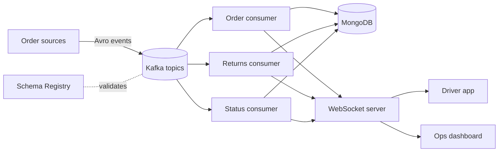

# DeliveryHub

**Role:** sole backend engineer · **Period:** Jul 2025 to Mar 2026
**Stack:** Node.js, Express, Apache Kafka (kafkajs), Avro, Confluent Schema Registry, MongoDB, WebSockets, Firebase, AWS EC2, PM2

## The problem

A delivery operation produces a constant stream of events: new orders, cancellations, returns, driver updates. Handling them through direct API calls between services gets fragile fast. Something is always down, and events get lost or processed twice.

## How it works

- **Events, not calls.** Order creation, cancellations, returns and status changes are all Kafka events. Producers don't need to know who is listening.
- **Schemas enforced.** Every event is serialised with Avro and checked against Confluent Schema Registry. A producer can't publish a shape consumers don't understand.
- **Multi-tenant consumers.** One consumer setup serves several tenants instead of a separate deployment per customer.
- **Real-time notifications.** Consumers push updates to drivers and operations staff over WebSockets, with Firebase push for mobile.
- **REST APIs** for orders, drivers, warehouses, zones and notifications.

## What I'd tell someone building this

1. **Use a schema registry from day one.** Changing an event's shape later is painful without one, and silent breakage is worse.
2. **Make consumers idempotent.** Kafka can redeliver. Processing the same event twice should be harmless.
3. **Decide early how tenants are separated.** Shared topics or per-tenant topics both work, but switching later means migrating every consumer.

Code is private. Happy to walk through the design in an interview.
