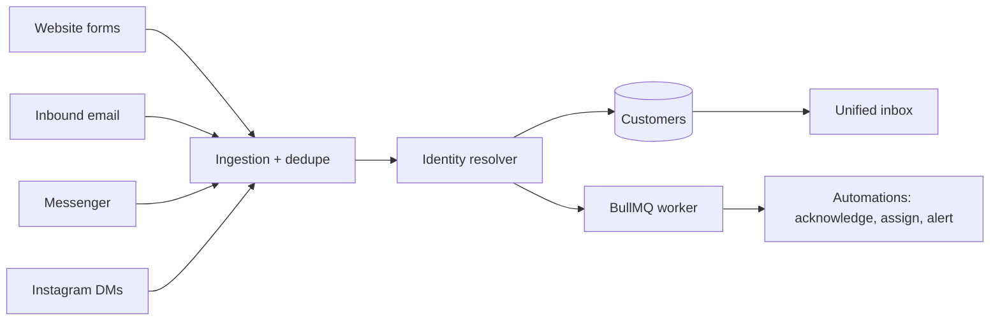

# Knownlead

**Role:** sole engineer · **Period:** Oct 2026 to present
**Stack:** TypeScript, Node.js, Express 5, MongoDB, Redis, BullMQ, React 19, TanStack Query, Radix UI, Tailwind, Zod, Vitest, Docker, AWS

## The problem

Small businesses get inquiries from everywhere: a website form, an email, a Facebook message, an Instagram DM. They end up in different inboxes, nobody knows the Instagram person is the same one who emailed last week, and leads slip through.

Knownlead pulls every channel into one inbox and works out who is actually a returning customer.

## How it works

- **Multi-tenant from the start.** Workspaces with Owner, Admin, Agent and Viewer roles, invitations and per-workspace data.
- **Ingestion.** Hosted and embeddable website forms with spam protection, inbound email as raw MIME through a forwarding webhook, and Meta webhooks for Messenger and Instagram.
- **Identity resolution.** Customers are matched on email, phone (normalised to international format) and platform IDs. A name match alone never links two people; it only shows up as a suggestion. Every merge can be undone.
- **Duplicate detection.** Duplicate webhook events are dropped. Duplicate inquiries are kept and marked, because a customer asking twice is useful information.
- **Automations on a worker.** Acknowledgements (with repeat suppression), assignment and returning-customer alerts run on BullMQ, not inside the request.
- **Security.** Third-party tokens and SMTP credentials are encrypted at rest with AES-256-GCM. CSRF protection, rate limits and TTL indexes for data retention.
- **Monorepo.** API, web app and a shared package with Zod schemas, so validation rules are written once and used on both sides.

## What I'd tell someone building this

1. **Never auto-merge on names.** It feels helpful until two different customers called Mohammed get merged.
2. **Make merges reversible.** If undo is hard, people stop trusting the feature and stop using it.
3. **Keep the raw record.** Store what each channel actually sent. Grouping and matching can change later; the original can't be recovered.

Code is private. Happy to walk through the design in an interview.
