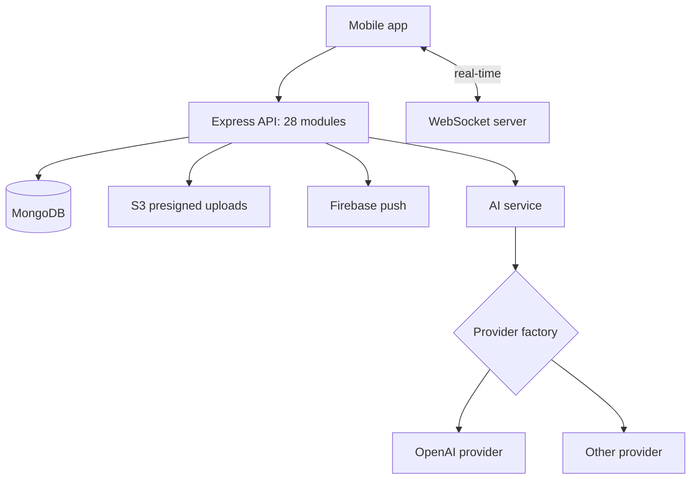

# RISE

**Role:** sole backend engineer · **Period:** May 2026 to present
**Stack:** Node.js, Express, MongoDB, WebSockets, JWT, Firebase Admin, Apple and Google Sign-In, AWS S3, node-cron

## The problem

RISE is a mobile running app: training plans, workouts, challenges with friends, and an AI coach you can chat with. The backend needs to handle a lot of different features without turning into one tangled file, and the AI part has to survive switching model vendors.

## How it works

- **28 feature modules.** Training programs, workouts, exercises, challenges, leaderboards, groups, badges, community, subscriptions and more. Each follows the same routes, controllers and models layout.
- **Swappable AI providers.** The coaching chat talks to one AI service, which gets a provider from a factory. Every provider extends the same base class, so adding or switching a vendor means writing one new provider class, not touching the app.
- **Auth.** JWT sessions with Apple and Google sign-in.
- **Uploads.** The app uploads straight to S3 with presigned URLs, so files never pass through the API.
- **Admin API** for metrics, events, user management and broadcast notifications.

## What I'd tell someone building this

1. **Wrap your LLM vendor on day one.** Models and prices change every few months. A thin provider interface costs an afternoon and saves a rewrite.
2. **Presigned uploads.** Don't proxy images through your API server.
3. **Keep feature modules boringly consistent.** Same folder layout, same naming. With 28 modules, consistency is what keeps it navigable.

Code is private. Happy to walk through the design in an interview.
